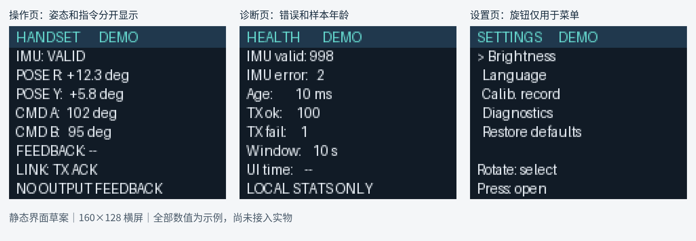

# 体感手控双轴云台

> 一起把手部动作变成看得见的机械运动：用 STM32、姿态传感器和 3D 打印，完成一个带状态显示的双轴云台实验平台。

**项目阶段：选题与方案设计｜正在寻找对软硬件、结构设计和测试感兴趣的组员。**

## 我们想做什么

做一个可以由手柄姿态操控的双轴云台。手柄读取姿态，通过无线模块传给云台端，云台随之转动；手柄上的彩屏展示姿态、指令和运行状态。我们会从开源资料出发，完成复现、设计改进、实物验证和项目总结。

这个项目有明确的动手成果，也能让不同方向的同学找到切入点：写程序、画和打印结构、连接电路、设计界面，或用数据验证一个改动是否真的有效。

```text
手部动作 → 手柄姿态传感器 → STM32 → 无线通信 → 云台 STM32 → 两轴舵机
                               ↓
                      彩屏：姿态、状态与诊断
```

本期以 **3D 打印结构、STM32 手控和中性载荷台架**为主要范围。摄像头和视觉识别可以作为后续独立扩展，目前没有纳入本期验收。

## 可以一起做的方向

| 方向 | 可能参与的工作 | 适合感兴趣的同学 |
| --- | --- | --- |
| 嵌入式与传感器 | 理解原工程，检查姿态数据有效性，记录状态与异常 | C 语言、STM32、传感器 |
| 无线通信与测试 | 理清数据链路，设计断链和恢复测试，整理日志 | 通信、调试、测试 |
| 机械与 3D 打印 | 审查开源模型，设计屏幕支架和中性载荷支架，打印试装 | CAD、建模、结构设计 |
| 显示与交互 | 为 ST7735 彩屏设计操作页、诊断页和设置页 | 界面设计、嵌入式显示 |
| 仿真与数据分析 | 建立载荷和供电预算，分析稳定性、重复性和响应数据 | Python、仿真、数据分析 |
| 项目记录与展示 | 整理装配记录、拍摄演示、撰写报告和制作展示材料 | 协作组织、文档、视频 |

不要求一开始就会所有内容。可以先从感兴趣的一项任务入手，和其他组员一起调试、学习和复盘。

## 彩屏界面设想



操作页、诊断页和设置页的示意图；图中数值均为演示数据。实际云台角度没有独立反馈时，界面会明确标注“未接入”。

## 目前有什么

- 已有开源项目的 STM32 发射端、接收端工程和 3D 打印模型资料，可作为复现基础。
- 已对原项目物料表、部分代码和显示屏资料进行初步梳理，并完成立项方案、物料清单和任务拆分。
- 初步方案使用 STM32F103C8T6、MPU6050、nRF24L01、MG996R 和 ST7735 系列彩屏；库存、具体屏幕型号和接口仍需实物核对。
- **目前处于设计阶段**：新显示方案尚未完成移植、硬件联调和精度实测，图示和任务不是已完成的产品。

## 接下来怎么推进

1. **盘点与熟悉**：确认材料、开发环境与原始模型，分配模块负责人。
2. **单模块实验**：分别观察姿态数据、无线状态和屏幕显示，形成接线与测试记录。
3. **装配与整合**：试打印双轴结构，安装中性载荷，完成手控与显示的联调。
4. **测试与改进**：围绕手柄静止稳定性、重复操作、响应时间及实际输出位置开展对照测试。
5. **整理与展示**：汇总代码、建模、测试数据、报告和演示视频。

初步计划约 8 周，具体进度、成员分工和预算由组员共同讨论；各项性能指标以实测为依据。

## 项目资料

- [立项书（Word）](docs/project-proposal.docx)：项目目标、技术方案、进度、物料与验收。
- [显示与操作品质升级方案](docs/display-and-evaluation.md)：显示接入、界面设计、待验证问题和测试思路。
- [完整协作资料包](docs/project-materials.zip)：立项书、准备清单、DeepSeek 任务及记录模板。
- [开源项目演示视频](https://www.bilibili.com/video/BV1of8y6vEQ5/)：原始开源项目的公开演示，仅作为背景参考。

本仓库当前以项目介绍和协作资料为主。原开源程序与结构模型的许可、版本和再分发条件需要核对后再整理进仓库。

## 欢迎加入

如果你对其中任何一个方向感兴趣，欢迎在本仓库的 [Issues](../../issues) 提出你的想法，或联系项目发起人。可以简单介绍你感兴趣的方向、希望尝试的任务，以及目前熟悉的工具；有零基础但愿意动手的同学也欢迎参与。
