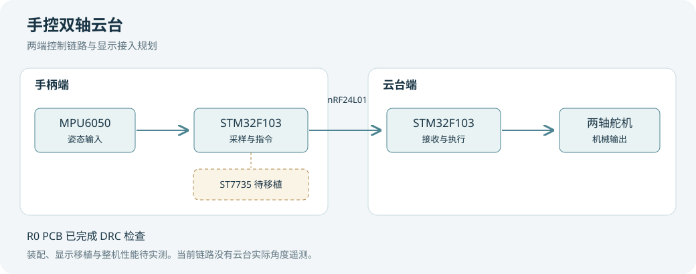
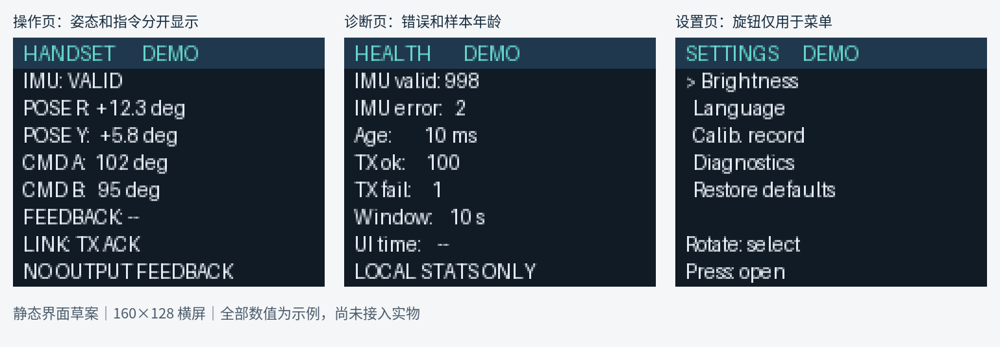

> 2026-11-05 结构方向修订：当前 PCB 安装在固定底座1～4的下部电子舱。新增背面可换接口板、线孔、扎带固定桥及试装承托框。[查看 SolidWorks R3 底座方案](mechanical/base-r3/)；此版为审阅候选，未制造放行。

# 体感手控双轴云台

> 一起把手部动作变成看得见的机械运动：用 STM32、姿态传感器和 3D 打印，完成一个带状态显示的双轴云台实验平台。

**项目阶段：R0 PCB 已通过布线检查，实物待验证｜正在寻找对软硬件、结构设计和测试感兴趣的组员。**

## 我们想做什么

做一个可以由手柄姿态操控的双轴云台。手柄读取姿态，通过无线模块传给云台端，云台随之转动；手柄上的彩屏展示姿态、指令和运行状态。我们会从开源资料出发，完成复现、设计改进、实物验证和项目总结。

这个项目有明确的动手成果，也能让不同方向的同学找到切入点：写程序、画和打印结构、连接电路、设计界面，或用数据验证一个改动是否真的有效。

```text
手部动作 → 手柄姿态传感器 → STM32 → 无线通信 → 云台 STM32 → 两轴舵机
                               ↓
                      彩屏：姿态、状态与诊断
```

本期以 **3D 打印结构、STM32 手控和中性载荷台架**为主要范围。摄像头和视觉识别可以作为后续独立扩展，目前没有纳入本期验收。

## 系统与当前状态



| 已有资料或实现 | 证据入口 | 下一步验证 |
| --- | --- | --- |
| 原始 STM32 两端工程与机械资料 | [原始项目](original-project/) | 建立原工程复现基线 |
| R0 集成 PCB 与布线检查记录 | [硬件目录](hardware/r0/) | 装配、上电与逐模块联调 |
| 彩屏页面与指标设计 | [显示与评价方案](docs/display-and-evaluation.md) | 驱动移植、刷新占时与输入有效性 |
| 手控整机性能 | 待台架实测 | 记录静止稳定性、重复性及响应数据 |

阅读顺序建议为本页 → R0 硬件说明 → 显示与评价方案 → 原始工程。单模块通过后再逐步组合，并为每次测试记录硬件版本、程序版本、输入条件和观察结果。

## 可以一起做的方向

| 方向 | 可能参与的工作 | 适合感兴趣的同学 |
| --- | --- | --- |
| 嵌入式与传感器 | 理解原工程，检查姿态数据有效性，记录状态与异常 | C 语言、STM32、传感器 |
| 无线通信与测试 | 理清数据链路，设计断链和恢复测试，整理日志 | 通信、调试、测试 |
| 机械与 3D 打印 | 审查开源模型，设计屏幕支架和中性载荷支架，打印试装 | CAD、建模、结构设计 |
| 显示与交互 | 为 ST7735 彩屏设计操作页、诊断页和设置页 | 界面设计、嵌入式显示 |
| 仿真与数据分析 | 建立载荷和供电预算，分析稳定性、重复性和响应数据 | Python、仿真、数据分析 |
| 项目记录与展示 | 整理装配记录、拍摄演示、撰写报告和制作展示材料 | 协作组织、文档、视频 |

不要求一开始就会所有内容。可以先从感兴趣的一项任务入手，和其他组员一起调试、学习和复盘。

## 彩屏界面设想



操作页、诊断页和设置页的示意图；图中数值均为演示数据。实际云台角度没有独立反馈时，界面会明确标注“未接入”。

## 目前有什么

- 已有开源项目的 STM32 发射端、接收端工程和 3D 打印模型资料，可作为复现基础。
- 已对原项目物料表、部分代码和显示屏资料进行初步梳理，并完成立项方案、物料清单和任务拆分。
- 初步方案使用 STM32F103C8T6、MPU6050、nRF24L01、MG996R 和 ST7735 系列彩屏；库存、具体屏幕型号和接口仍需实物核对。
- **当前进度为设计与 PCB 检查阶段**。新显示方案、硬件联调和精度实测仍待验证，页面示意图用于表达界面设计。

## R0 集成 PCB 与装配资料

一套设备使用两块相同的四层 PCB，手柄端和云台端各装一颗 STM32F103C8T6，按各自用途装配并烧录。板图已通过嘉立创 EDA 原生 DRC，装配和联调仍待验证。

- [R0 硬件说明](hardware/r0/)
- [嘉立创 EDA 专业版工程](hardware/r0/gimbal-r0.epro2)
- [两端配件清单 Excel](hardware/r0/assembly-bom.xlsx)
- [PCB1 原生 DRC 记录](hardware/r0/pcb1-drc.json)

## 接下来怎么推进

1. **盘点与熟悉**：确认材料、开发环境与原始模型，分配模块负责人。
2. **单模块实验**：分别观察姿态数据、无线状态和屏幕显示，形成接线与测试记录。
3. **装配与整合**：试打印双轴结构，安装中性载荷，完成手控与显示的联调。
4. **测试与改进**：围绕手柄静止稳定性、重复操作、响应时间及实际输出位置开展对照测试。
5. **整理与展示**：汇总代码、建模、测试数据、报告和演示视频。

初步计划约 8 周，具体进度、成员分工和预算由组员共同讨论；各项性能指标以实测为依据。

## 项目资料

- [立项书（Word）](docs/project-proposal.docx)：项目目标、技术方案、进度、物料与验收。
- [显示与操作品质升级方案](docs/display-and-evaluation.md)：显示接入、界面设计、待验证问题和测试思路。
- [完整协作资料包](docs/project-materials.zip)：立项书、准备清单、DeepSeek 任务及记录模板。
- [开源项目演示视频](https://www.bilibili.com/video/BV1of8y6vEQ5/)：原始开源项目的公开演示，仅作为背景参考。

完整资料现已整理为：

- [原始云台项目](original-project/)：STM32 两端工程、3D 模型、Gerber 和原物料清单。
- [完整原始资料归档](original-project/full-original.zip)：包含原始工程和构建产物，下载后解压使用。
- [显示项目参考](reference-display/)：ESP32-C3 显示程序与电路图，公开版本已清除 Wi-Fi 信息。
- [立项与协作文件](planning/)：立项书、准备清单、任务说明和测试记录模板。

原始资料及其第三方组件的许可证仍需向原作者核实；保留原有版权声明。

## 欢迎加入

如果你对其中任何一个方向感兴趣，欢迎在本仓库的 [Issues](https://github.com/EthanN1e/X1aoChuang-NYH/issues) 提出你的想法，或联系项目发起人。可以简单介绍你感兴趣的方向、希望尝试的任务，以及目前熟悉的工具；有零基础但愿意动手的同学也欢迎参与。


## 项目总结与阶段归档

- [体感云台设计阶段结项总结](docs/reports/gimbal-closeout.md)

总结附系统图、个人工作、成果与验证状态。待验证项继续随工程更新。


## 最新板级与外壳评审（2026-11-05）

[查看 R0 现场复查、三维展示和候选碰撞记录](hardware/r0/review-20261105/README.md)。PCB DRC 未报告违规；原壳兼容性仍未通过候选检查，当前不作为制造放行版本。下载该目录中的 `装配展示.html` 可离线旋转查看真实模型。
