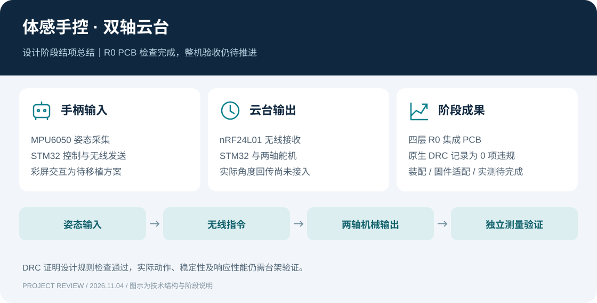
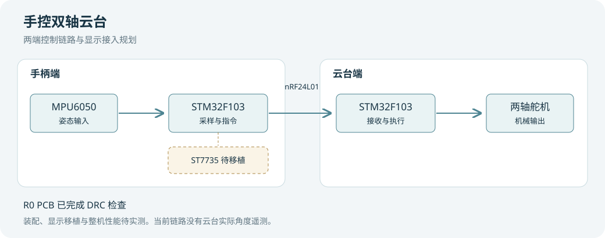

# 体感手控双轴云台 · 设计阶段结项总结

> 阶段归档日期 2026-11-04 · 小创项目推进中  
> 聂允恒｜项目组长｜本次归档范围为需求梳理、系统方案与 R0 PCB

## 🎯 背景与阶段目标

项目希望将手柄姿态转换为双轴云台运动，并通过彩屏显示输入、指令和运行状态。沿用已有 STM32 两端工程及机械资料，逐步完成复现、接口整理、硬件集成和交互设计。

本阶段围绕中性载荷台架整理技术方案与交付资料。当前已具备 R0 PCB、物料与显示方案，实物装配、固件适配和整机性能验证仍在后续计划中。因此，本文件归档设计阶段成果，整体项目继续推进。

## 🛠 个人承担的工作

- **明确系统分工**。围绕姿态输入、无线链路、两端控制、机械结构和显示交互拆分模块，为不同方向的成员提供协作入口。
- **组织设计资料**。整理原始工程、R0 PCB、两端物料与装配说明，使方案能够对应到具体文件和接口。
- **梳理显示需求**。规划操作、诊断和设置页面，区分手柄姿态、发送指令和实际机械反馈，避免将界面数值误认为已测得的云台角度。
- **安排验证路径**。以模块检查、装配联调和台架测量逐步推进，将稳定性、重复性和响应表现转化为后续记录项。

## ⚙️ 技术方案与交付成果

| 部分 | 方案或交付物 | 当前完成情况 |
| --- | --- | --- |
| 手柄端 | STM32F103C8T6、MPU6050、nRF24L01 | 原工程与集成资料已整理，R0 适配待完成 |
| 云台端 | STM32、无线接收、双轴舵机与结构资料 | 原工程可供复现，装配与实物动作待验证 |
| 集成硬件 | 56 × 80 mm 四层 R0 PCB，一套两块同版板 | EDA 工程与 BOM 已归档 |
| 设计规则检查 | 原生 DRC 结果 `passed: true`、`violations: []` | 2026-11-03 记录为 0 项违规 |
| 显示交互 | ST7735 操作页、诊断页和设置页方案 | 驱动移植、资源占用及实机显示待验证 |

## 🧩 设计取舍与问题识别

显示层需要解释信息的来源。无线发送成功可以用于描述部分链路状态，但不能据此判断舵机已经到达目标位置。在没有独立角度反馈时，实际角度应标为未接入。

新显示方案还需要核对屏幕接口、内存及刷新耗时。当前方案采用局部绘制思路，具体资源占用和刷新对主循环的影响必须在移植后检查。设计审查发现的姿态读取、数据有效性与异常输入问题，也应在后续固件适配时逐项处理。

PCB 的 DRC 结果说明当前设计满足所检查的规则。模块针序、供电余量、机械安装以及实际控制效果仍需通过装配和实验确认。

## ✅ 验收状态与后续安排

| 验收项 | 当前状态 | 下一项证据 |
| --- | --- | --- |
| R0 PCB 原生 DRC | 已有通过记录 | 保留工程版本和检查文件 |
| 装配、供电与接口 | 待验证 | 装配照片、上电检查及接线记录 |
| 显示与输入移植 | 待验证 | 编译结果、界面照片及输入日志 |
| 两端无线联调 | 待验证 | 收发、异常与恢复记录 |
| 整机操作表现 | 待验证 | 独立测量的稳定性、重复性与响应记录 |

## 💡 阶段复盘

当前工作的价值在于把概念方案推进到可交接的工程材料，并为后续实验明确检查顺序。小组协作需要共同理解接口和状态含义，文档应使接手者知道已有成果在哪里、下一步验证什么、怎样记录结果。

本阶段尚无可报告的精度提升、延迟降低或整机成功率。后续先建立可复现的台架基线，再讨论优化效果。

## 📦 归档入口

- [R0 硬件与装配说明](../../hardware/r0/README.md)
- [原生 DRC 记录](../../hardware/r0/pcb1-drc.json)
- [显示与评价方案](../display-and-evaluation.md)
- [原始工程](../../original-project/)
- [立项与协作文件](../../planning/)

原始工程及第三方资料保留其版权声明。此总结记录个人组织与设计整理工作，不将开源基础工程全部计为个人原创成果。
