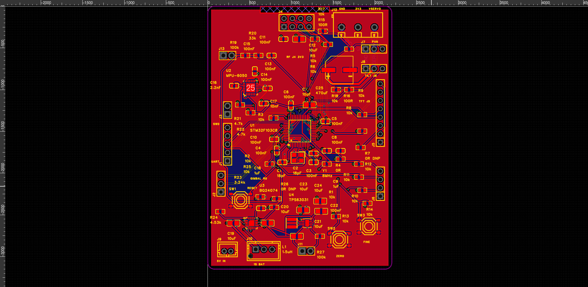

# R0 板级复查与外壳装配评审

2026-11-05，使用 jlc-easyeda-design 与 product-enclosure-design。

**本次结论：现场 PCB DRC 未报告违规，但原壳兼容性尚未通过，当前不是制造放行版本。**

## 展示

下载并用支持 WebGL2 的现代浏览器打开 `装配展示.html`。数据已内嵌，可离线旋转、缩放、按分件隐藏和分解查看。包含原始手柄、原始底座、其余原始零件，以及从在线 EDA 实际导出的 PCB 和器件几何。候选模式中红色部分是 PCB，不代表已经完成适配。浏览器交互运行未做自动化验收；已完成脚本语法检查。

## 中间悬空引脚

本次重新保存、关闭并打开目标 PCB1，原生严格 DRC 返回空违规列表。实际网表中 U1 有 8 个未用脚；U2 有 14 个未接脚（含中心 25 号焊盘）；U3 的 PGOOD、TMR、ITERM 三脚按当前设计有意不接；J4 的 IRQ 未用。此前已经添加 NC 标记并完成原理图检查。

这些事实能够解释部分裸露焊盘，但 **DRC 零违规不证明三维引脚一定贴板、全部电路功能正确或制造输出合格**。实际 OBJ 作为独立几何证据归档。没有对用户看到的每一个三维引脚执行接触面测量，不能把视觉疑问全部结案。需要结合精确引脚位置、铜层、焊盘与模型接触共同检查，不能通过隐藏模型或删除焊盘消除疑问。

`live-drc-readback.json.gz`（解压为 JSON） 保留本次检查、完整 PCB 网表、元件焊盘、走线与规则，便于复查。最近一轮电气修改仍以 2026-11-05 的 NC 标记、丝印补充和部分电源加宽为范围；本轮没有为获得通过而放松规则或重新改写网络。

## 外壳来源与碰撞

仓库基线 `17c5a047d593fabc90187a6aba8deebe408d9ef6` 中的 `original-project/开源模型` 为本次来源。本地 13 个 STL 的 Git blob SHA 与仓库逐项一致。源模型保持原貌，未将零件间的相同坐标擅自解释为全部零件的完整总装。

手柄两半壳的合并外包络约 30×58×163.29 mm，第三壳约 30×28×80 mm。尺寸按项目中的 mm 解释，STL 自身无单位。PCB 为 56×80 mm，器件与引脚还需要额外高度和线缆空间。

使用三角形—长方体的 13 分离轴测试，沿 Z=90～160 mm、间隔 5 mm，检查 15 个固定方向的矩形裸板包络候选位置，均发现与原始手柄壳三角面相交。示例候选为 X=13.4～15、Y=1～57、Z=120～200 mm，有 22 个相交壳体三角面。

此处 1.6 mm 板厚为候选包络假设；测试是矩形包络检查，未计圆角与完整元件、插头、线缆，也没有穷举任意旋转或证明腔内包含关系。结果只足以拒绝这组候选，不能推导所有安装方向都不可能。详细记录见 `候选装配碰撞扫描.json`。

外壳需求继续采用“尽量保留主体外观，局部改内腔及固定结构，胸抱支撑可拆卸”的既定约束。下一次结构修订应先在原生 CAD 中确定可行板位和插拔包络，再比较局部内腔修改、PCB 外形调整或可拆卸外置电子舱。当前没有伪造新的精确 STEP、已适配外壳 STL 或打印合格结论。

## 文件与状态

- `gimbal-r0.epro2`、`review-gerber.zip`：当前复查归档，Gerber 尚未完成板厂 DFM。
- `pcb-assembly-obj.zip`：EDA 实际三维导出，223297 个三角面；模型接触与高度尚未逐件验收。
- `装配展示.html`：离线三维展示。
- `模型尺寸与拓扑记录.json`：尺寸、源哈希与基础边拓扑记录；不替代自交、壁厚、强度及打印检查。
- `候选装配碰撞扫描.json`：可复现的候选拒绝证据。
- `build_showcase.py`、`check_fit.py`：可复现生成与检测脚本，基于原始模型及实际 EDA OBJ。

尚未完成板厂 DFM、全量三维引脚接触检查、开关电源专项优化、屏幕完整针序与背光核对、舵机电流确认、原壳改模、整机装配和实测。立项资料与历史原始工程继续保留。
