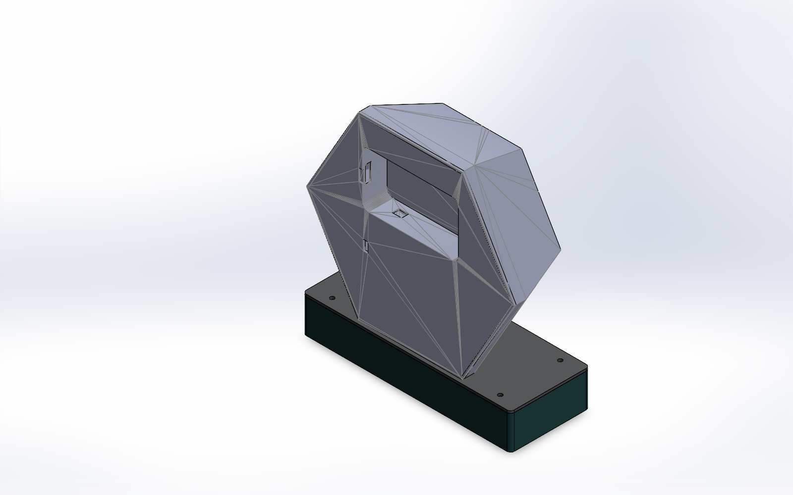
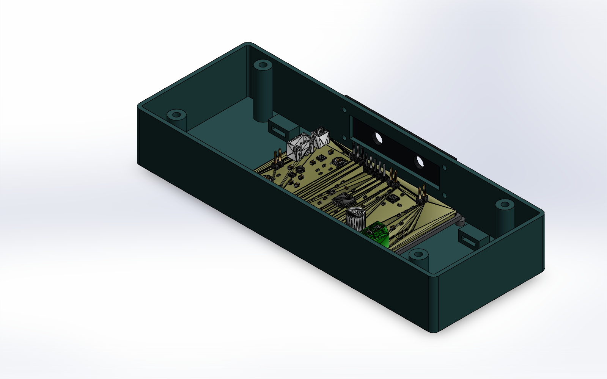

# R3 固定底座 PCB 与背面接口板审阅版

2026-11-05。源基线 `d514bc1719a29fc69db6abdebece5af03d40f287`。本版按用户确认改为固定支撑“底座1～4”，PCB 不装在发射机构或其侧舱；Yaw 底座不在本次修改范围。

## 设计选择

仓库最新原件和 EDA 实际 `pcb-assembly-obj.zip` 已同步。本轮不改 PCB 网络、板框、器件或规则；采用最新几何建立结构约束。当前无在线 EDA 会话，因此没有在本轮重新运行 ERC/DRC，不把仓库历史 DRC 结果写作本轮现场通过。

先检查固定底座内部的 20 个矩形裸板候选（80边沿源X，56边沿源Z），均与原件三角面相交。该扫描只拒绝这组候选，没有穷举全部姿态。原底座2仅凭外廓不能认定有可用内腔。为避开既有结构，在底座下方增加可拆电子底舱，保留原主体作参考；PCB 水平安装，未改原主体内部。

## 已建模的功能与尺寸

单位 mm。以下为 CAD 候选尺寸，打印配合公差尚未实测。

| 项目 | 尺寸及定位 |
|---|---|
| 新底舱外形 | 173.20508×66；含盖和支脚总高33；背面接口板额外突出2，局部总深68 |
| 壁、底、盖 | 名义2；外角R3、内角R1，独立盖板 |
| 盖板及底舱固定孔 | 4×Ø3.4通孔（M3间隙候选），以底舱XY中心定位：(±70,±25)；不是螺纹孔 |
| 支脚 | 4×Ø8，中心(±78,±25)，低于底面3；螺钉头及防滑垫仍需实物确认 |
| 背面可换接口板 | 64×22×2；背面窗口52×12，中心位于底舱零件坐标X0/Z14，背墙Y33 |
| 接口板固定 | 4×Ø2.4通孔（M2间隙候选），板面中心为基准：(±29,±7)；舱体对应孔同轴 |
| 线束试配孔 | 2×Ø6，板面中心为基准：(−12,0)、(12,0)；用于穿线试配，不能承诺带插头穿过 |
| 扎带固定桥 | 两处，底舱XY中心为基准X±55/Y22；桥体12×6×6，过带净槽8×2，距内底面2 |
| PCB承托框 | 独立试装件，外58×82、内54.8×78.8、框厚2；四处Ø4支承脚高2.2 |

原底座源Z为竖直方向。显示总装统一变换为(X,Y,Z)→(X,Z,−Y)，避免把轴向误读成后置电子箱。源坐标下：底舱内底面Z−28、盖底面Z−2、支脚最低Z−33。PCB OBJ原点放在(126.60254,83.79538,−22)，本地X→源−Y、本地Y→源X、本地Z→源Z。

最新OBJ总体Z包络−4.2..10.096315，因此最低焊脚至内底面包络间距约1.8，最高几何至盖底约9.904；这不包含尚未建模的带线插头、模块或线缆弯折。板边距前后内壁约3。承托框位于OBJ板面下约1.8，实际边缘最低几何与框顶之间约0.036；这是试装起点，不能当作打印公差。框只承托，不等于已经锁固，防抬起压条及定位校准仍待完成。

## 线材与使用方式

背面接口板集中出线；一侧预留电源/负载线束，另一侧预留信号/通信线束。线束进入后先用固定桥和扎带承受拉力，再接PCB，不让插座或焊点承受外部拉扯。固定桥布置在PCB两端之外；其净槽已在实际导出STL中用采样射线读回复核。没有真实线材和护线圈尺寸，未宣称应力释放、抗干扰、弯曲半径或插拔合格。

目前Ø6孔为可替换试配方案，应配合实际护线圈/防磨套；固定板换孔型后不需要重做主体。需要带插头直接穿孔时，要按接头包胶最大外形重开接口板。没有安装护线圈时不建议把裸打印孔作为最终线缆摩擦面。接口标识、护线圈、接头防转和具体电源开关布局留在下一轮接口板中确定。

## 实际验证及限制

- 新件草图完全定义，无批量Fix；圆角、接口板窗口、线孔、固定桥、支脚均已实际建模，导出STEP/STL。
- 总装保存重开，9个组件可加载。原PCB是实际EDA导出的图形网格参照，不是已恢复的参数化精确B-rep。
- STL回读：新件基础边拓扑、法向和零面积检查见mesh-checks.json。此检查不证明无自交、全局最小壁厚、强度或打印合格。
- 开口采样验证：窗口中心只穿过前墙，不穿过背墙；窗口侧面仍穿过两面墙，证明背面开口方向正确；M2孔和扎带槽也有导出后读回记录。见opening-readback.json。
- 原底座1与4按源坐标组合时已有8处实体重叠（最大约1312.99mm³）。最终原生干涉报告保留这些项目，未通过删除源几何或关闭检查掩盖问题；不能宣称整机干涉通过。
- 目前需要实物确认：原底座1～4最终装配关系、新底舱与原底座连接点、PCB防抬起锁固、M2/M3紧固件长度及工具可达性、实际线径/插头/护线圈、完整布线、打印材料与防滑脚垫。未测试承载、跌落、热、EMC或防水。

## 文件

`R3-Base-PCB.SLDASM`为整合参考；`R3-PCB-Access.SLDASM`为开盖审查视图（原底座和盖板被压缩，仅用于查看内部）。所有引用SLDPRT应与装配同目录。四个新增零件均提供原生SLDPRT、STEP及STL；原始模型保留原来源，不恢复或冒充原参数化特征。完整总装含图形网格，不将它宣称为完整精确STEP。

本版取代“在发射机构侧面装PCB”的结构方向，属于可继续修改的审阅候选，尚未制造放行。

下载仓库分支ZIP并解压后，在此目录运行 `./Restore-Review.ps1`，合并校验download分卷，解压生成的R3-SolidWorks.zip即可打开完整原生总装。单独新件STEP/STL也在此目录。
