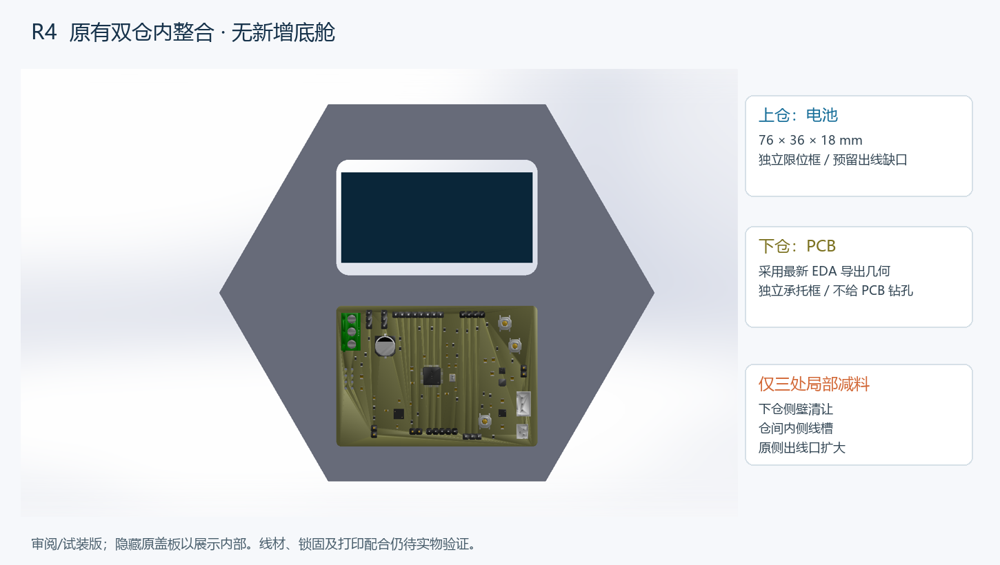

# R4 原底座双仓内整合：76×36×18 电池 + 最新 PCB

2026-11-05，基线main `d514bc1719a29fc69db6abdebece5af03d40f287`。本版替代 R3 新增33 mm底舱方向，按用户新要求尽量保留原设计。没有扩大外壳或改动两个悬臂；PCB在原下仓，电池在原上仓。

用户确认电池名义尺寸为 **76×36×18 mm**。来源为 `Downloads/开源模型` 的底座1～4（与仓库原件字节相同），参考[原制作视频](https://www.bilibili.com/video/BV1of8y6vEQ5/)约70～85秒装配段。视频仅用于理解原有仓位，不作为精确尺寸来源。没有附带或重发布视频画面。

## 修改范围

- 底座1仅三处局部减料，外包络仍为173.205078×27.600000×150 mm，未新增电子底舱。减料约1949.56 mm³，约原体积3.75%。
- 底座2～4几何不改；底座3在装配中沿原源Y外移1 mm，为薄衬垫/盖内限位留候选余量，需要确认紧固件长度。
- 新增独立PCB承托框和电池限位框；PCB不钻孔。限位框的出线缺口为盲切，框体保持一体。
- R3的大型背面接口板不再强加到原外形上。先利用原侧出线口并局部扩大；如后续需要可换接口件，应在原开口范围内按实物接头再定，不继续采用R3大底舱。

## 孔槽与定位

单位mm。**使用原始STL源X/Y/Z坐标**；展示总装变换为(X,Y,Z)→(X,Z,-Y)。切削包络包括切入壁外的部分，不等于处处都有材料。

| 项目 | X范围 | Y范围 | Z范围 / 规格 |
|---|---|---|---|
| 下仓侧壁清让 | 46.10254～127.10254 | 27.485271～53.486271 | 13.3～70.3；候选净宽81、净高57 |
| 两仓内侧连接槽 | 82.60254～90.60254 | 32～44 | 69～83；切削包络8×12×14 |
| 扩大原侧出线口 | 42.5～48.5 | 31～37 | 50～62；切削包络6×6×12 |

| 新件 | 尺寸和定位 |
|---|---|
| PCB承托框 | 外80×56、内78.8×54.8、边厚2、总高12.7；四个实心Ø3.4脚中心(±38,±26)，不是安装孔 |
| PCB承托装配 | 源原点(86.60254,40.1853,41.8)，局部x→源X、局部y→源Z、局部z→源-Y |
| 电池限位框 | 外79×39×18.8、内77×37；两个8×3草图缺口在(0,±19)，盲切深3，非贯穿整高 |
| 电池框装配 | 源原点(86.60254,46.5,105)，轴向同承托框 |
| 电池名义盒 | 76×36×18；源X48.60254～124.60254、Y28.5～46.5、Z87～123；不含出线/接头 |
| PCB参照 | 最新EDA实际OBJ，本地X→源Z、本地Y→源X、本地Z→源Y，原点(126.60254,42,13.8) |

PCB裸板约80×56，候选腔81×57，边缘名义余量约0.5/侧。实际OBJ总厚度包络源Y37.8～52.096315，距原下盖结合平面Y53.485271约1.389；这个距离不含带线插头和线缆弯折。承托边与板边下方几何的名义距离约0.051，不能当作打印配合通过。电池内框相对名义长宽各增加1，原仓底到电池最低面约1.015，可安排绝缘衬垫候选。

## 接线与固定

两仓之间的内侧线槽用于电池引线；外部线束利用原侧开口。电源/负载线与信号线分束、贴仓壁固定，避免横压PCB；插座和焊点不承担外拉力。线径、接头包胶、护线圈/防磨件、最小弯曲半径尚无实物数据，孔槽为试配值，尚未证明全部带插头线束可穿过。未验证应力释放或抗干扰性能。

承托框用于支承和定位，不代表已经完成防抬起锁固；电池框是开底限位框，需结合绝缘衬垫和盖内限位确认电池可靠保持。薄边和1 mm框壁均是打印试装候选，材料/工艺未定。尚未进行强度、热、抗振、跌落或EMC验证。

## 已做复核及边界

- 原底座源文件未覆盖，源hash和三处切削包络见`local-change-evidence.json`。
- 两份SLDASM重开检查，8个组件路径可读；闭合装配原生实体干涉0项。**PCB是EDA图形网格参照，不参与实体干涉求解**，因此不能把0项写成完整电气装配配合通过。
- 新增承托框、电池框为原生参数零件，草图完全定义；电池框实际单实体。底座1为局部布尔网格导入的实体，不宣称恢复原参数树。
- 交付STL基础边拓扑、法向、退化三角检查通过。SW对底座1的再次STL导出产生28条精确坐标开放边，已拒绝用于打印；交付`R4-Base1.STL`采用已验证并用于创建原生实体的精确布尔源网格，保留导出异常记录在`mesh-export-provenance.json`。未用容差焊接掩盖问题。
- 新框的打印STL被SW平移到全正坐标；底座1STL保留源坐标。安装姿态以原生SLDASM及`native-evidence.json`的变换为准，不把独立打印坐标当装配坐标。
- 两张原生三视图及PDF已保存重开，最终尺寸文字对应与碰撞检查通过；仅作为试装审阅图。底座1孔槽用源坐标定位表说明，未声称有完整关联尺寸的制造图。完整制造公差、材料、标题栏业务字段及锁固验证仍未定稿。
- 本轮只改机械设计，没有更改PCB网络/布线，也没有现场重新运行ERC/DRC或电气仿真，不将历史结果写作本轮通过。

## 打开文件

- `R4-Original-Layout.SLDASM`：原轮廓闭合布局；`R4-Open-Review.SLDASM`：压缩底座2/3/4以查看两个仓位。
- 全部SLDPRT与装配放在同一文件夹。最新PCB为实际图形参照，完整装配不冒充精确B-rep STEP。
- 修改底座、两种框提供STEP/STL；两张试装图提供SLDDRW/PDF；`R4-Design-Review.pdf`为三页中文方案和定位表。
- 本地ZIP可直接解压。仓库分卷下载后，在本目录运行 `./Restore-Review.ps1` 校验合并，解压所得`R4-SolidWorks.zip`。

下一步以实际PCB、电池和带接头线束试装，确认盖板啮合、PCB防抬起、绝缘和电池保持，再按实物修正孔槽/锁固。本版为可修改审阅候选，未制造放行。
