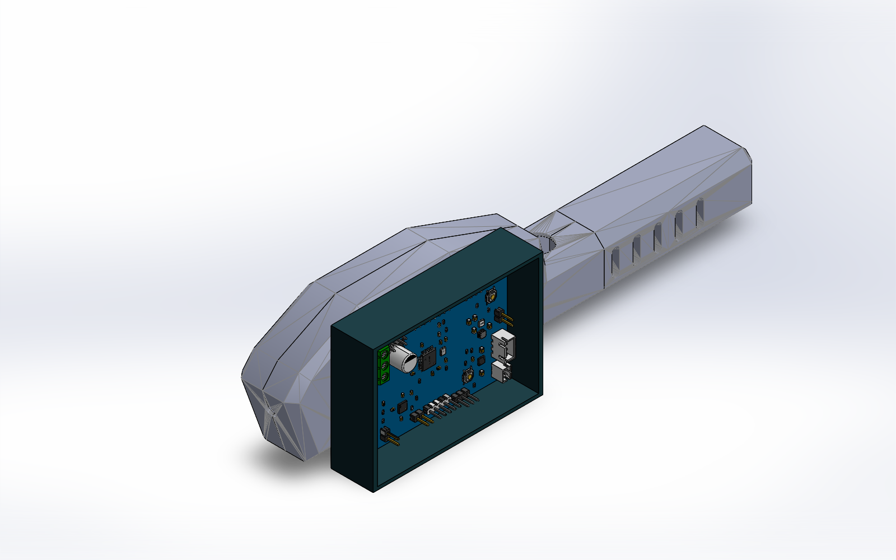
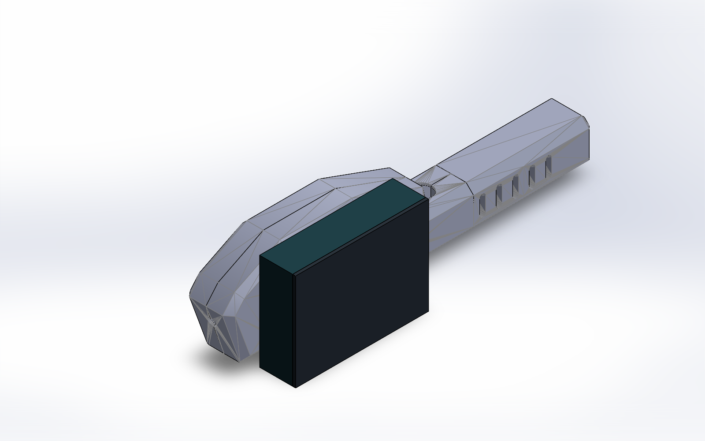

# R1 手柄局部扩展舱整合审阅版

日期：2026-11-04。SolidWorks 2025 SP5.0。单位 mm。

本版把仓库原有的三件主体壳、真实带器件 R0 PCB、可编辑扩展舱和独立盖板放到同一装配中，提供开盖/闭盖两套模型。它是可审阅的结构候选，尚未完成实物试装和固定机构设计。

## 下载原生装配包

完整审阅包约 66 MB。仓库以 `download/R1-SolidWorks-Review.zip.001` 起的连续分卷保存二进制原件，并附每卷及整包 SHA-256。下载本审阅分支的仓库 ZIP、解压后，在 `mechanical/r1` 目录运行 `./Restore-Review.ps1`，会校验全部分卷、合成 `R1-SolidWorks-Review.zip`；再次解压即可打开 SolidWorks 总装。脚本只在当前目录生成新文件，遇到已有输出会停止，不会覆盖。

也可使用支持 `.zip.001` 分卷的解压软件。页面上的开盖/闭盖预览可直接审看，无需先安装 CAD。

## 文件与使用

- `R1-Integration-OPEN.SLDASM`：开盖，5 个组件。
- `R1-Integration-CLOSED.SLDASM`：闭盖，6 个组件。
- `R1-Original-Shell01/02/03.SLDPRT`：原壳网格参照，保留原共同坐标；没有恢复上游的参数化特征树。
- `R1-Pod-Body.SLDPRT`、`R1-Pod-Lid.SLDPRT`：新建参数化扩展舱和独立盖板；草图完全约束、没有使用 Fix 代替尺寸；保存重开检查通过。
- `PCB-R0-Reference.SLDPRT`：真实 EDA STEP 转为 245 个实体的参照零件；包含原工程全部候选位号的可用模型，不等同手柄 63 件的已焊状态。J4 无线模组模型缺失，不能据此放行天线舱。
- 新件 STEP 及原始带器件 PCB STEP、两件 `-TRIAL.STL`、四视图、`native-evidence.json`、`design_plan.json`、来源散列及建模脚本随包提供。

解压后保留所有 SLDPRT 与 SLDASM 在同一目录，先开 OPEN 或 CLOSED 装配。原生总装已保存重开并确认引用组件均加载。STL 是尺寸试片，尚未配置打印机、喷嘴和材料；本版没有伪造已切片的 3MF。

## 原模型整合依据

仓库 `original-project/开源模型/` 中的 `枪体壳1.STL`、`枪体壳2.STL`、`枪体壳3.STL` 及 `体感云台发射器打印模型.3mf` 与 Windows 交接包相应文件 SHA-256 一致。原 3MF 有 13 个对象、7 个打印排盘，排盘变换不作为装配关系。Pitch/Yaw 轴、底座及其他上游件保留在原目录，属于云台端或未确定用途，不随意拼到手柄总装。来源与各文件散列见 `source-provenance.json`，本版本未改变其授权或归属。

## 空间选择与尺寸

原主体三件源坐标：壳1 X0..15/Y0..58/Z80..243.2899；壳2 X15..30、其余相同；壳3 X0..30/Y0..28/Z0..80。

56×80 PCB 平放在原长主体 YZ 面内时，原外截面能连续容纳宽56的长度仅约57.4；取76长的有效板宽段，最佳外部最小宽度约52.1，尚未扣壁厚已经差约3.9。因此本轮选择独立侧面扩展舱候选，保留原主体的外形作对照。上述仅排除了已检查的平放姿态，没有证明所有斜放姿态都不可能。

| 项目 | 参数/结果 |
|---|---|
| 名义 PCB | 56×80，R约2 |
| STEP 板体 | 55.9746×79.97485×1.69369（文件几何值，非实测板厚） |
| 扩展舱外形（含盖） | 宽64.6×长88.6×总厚24 |
| 舱体壁厚/底厚 | 2/2，试装假设 |
| 内腔 | 60.6×84.6×20 |
| 盖板 | 64.6×88.6×2，尚无卡扣或螺钉锁固 |
| 舱体坐标 | X30.5..52.5，Y−4.3..60.3，Z134.4..223.0 |
| 盖板坐标 | X52.5..54.5，Y−4.3..60.3，Z134.4..223.0 |
| PCB 变换 | 板本地 X→原壳Y、本地Y→原壳Z、本地Z→原壳X；原点(36.5,0,218.7) |
| 名义板边至内壁 | 宽/长方向每侧2.3 |
| 板底至舱底内面 | 4（底部焊脚需逐件核实） |
| 原壳最大X面至舱体背面 | 0.5；当前为空间预留，未建承力连接 |

扩展舱局部坐标：矩形以(0,0)居中，底板 Z−2..0，壁 Z0..20；盖独立零件 Z0..2，通过装配变换放到舱口。新件草图尺寸可编辑；最终公差需打印样片校准。

## 验收与未验证项

开盖、闭盖分别运行原生干涉检查，结果与选项见 `native-evidence.json`。本检查不包含模组缺失、按钮行程、插拔路径及线束弯折，原壳网格参考也不能替代精确内腔逆向设计。器件内部同一零件的多实体干涉被关闭，避免将焊接接触面算作装配冲突。

当前 PCB 与电子舱是固定变换的布局参照，尚未建可承力的 PCB 托架/夹持点；PCB 不新增钻孔。扩展舱与原壳的连接、盖板锁固、屏幕支架/窗口、编码器承力与防转、SW2/SW3 按钮导向、电池独立固定、无线模组/天线净空、开关和充电线出口及应力释放均待后续设计与实物核实。不能按本版打印后直接认定为完整可用外壳。

下一轮需要电池外形及出线、屏幕板和可视区、编码器轴/螺纹/轴长、J4 模组插入后高度、带线插头包络、实板厚度和打印机/材料参数。当前尺寸有意作为审阅假设公开，相关接口没有凭空定稿。

PCB 修复和云端 DRC 结论见同仓库 `hardware/r0/review-20261104/`。DRC 通过不等于完整 SPICE 仿真、EMC 或实物通过。

完整总装 STEP 导出未通过文件落盘验收：本机接口返回成功但未生成目标文件，不能把返回值视为成功。整合结果以已保存重开的 SolidWorks 原生总装和预览为准；提供真实存在的新件 STEP、原始 PCB STEP 和上游网格，未伪造或改名生成 STEP。

交付包独立加载验证：暂时使原建模目录不可用，从分卷还原并解压后的目录重开闭盖总装，6 个组件全部从解压目录加载，重建成功。证据见 [portable-verification.json](portable-verification.json)。
